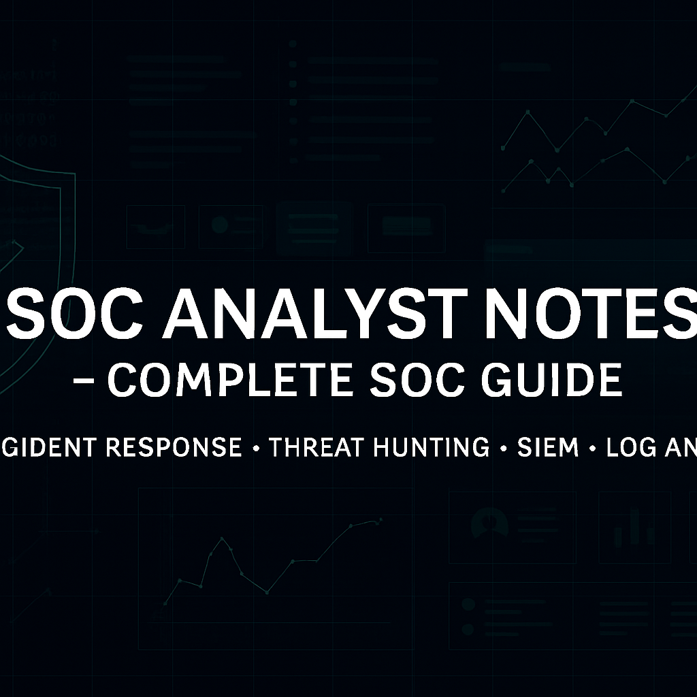

  

# 🛡️ SOC Analyst Notes – Complete Beginner to Advanced SOC Guide 🚨

Welcome to the **SOC Analyst Notes Repository** — a **comprehensive, SEO-optimized learning hub** for mastering the **Security Operations Center (SOC)** ecosystem.  
From **incident response** to **threat hunting**, **SIEM mastery** to **phishing detection**, this guide equips you with the skills and knowledge to excel as a SOC professional.

---

## 📚 Explore Wiki Topics

1. [Introduction to SOC](https://github.com/MaheshShukla1/Soc-prep/wiki/Introduction-To-SOC#6-case-study-responding-to-a-phishing-attack)  
2. [Cyber Defence
 Framework](https://github.com/MaheshShukla1/Soc-prep/wiki/Cyber-Defence-Framework)  
3. [Cyber Threat Intelligence (CTI)](https://github.com/MaheshShukla1/SOC_NOTES_2024/wiki/Cyber-Threat-intelligence)  
4. [Network Traffic Analysis](https://github.com/MaheshShukla1/SOC-Security-Notes/wiki/Network-Traffic-Analysis)  
5. [Phishing Detection & Response](https://github.com/MaheshShukla1/SOC-Analyst-Notes/wiki/Phishing-Attacks:-Understanding,-Detection,-and-Prevention-Strategies)  
6. [Alert Management & Triage](https://github.com/MaheshShukla1/SOC-Analyst-Notes/wiki/Alert-Management-&-Triage)  
7. [Log Analysis Basics](https://github.com/MaheshShukla1/SOC-Analyst-Notes/wiki/Log-Analysis-Basics)
   
---

## 🧩 Core Learning Modules
✅ **SOC Workflow** – From detection to remediation, learn the SOC alert lifecycle  
✅ **Threat Actor Analysis** – Understand TTPs, IOCs, and attacker motivations  
✅ **SIEM & Log Analysis** – Master log aggregation, correlation, and analysis  
✅ **Alert Management** – Validate, prioritize, and escalate alerts effectively  
✅ **Incident Response (IR)** – Triage, containment, eradication, recovery steps  
✅ **Phishing Defense** – Detect, analyze, and mitigate phishing campaigns  
✅ **Threat Hunting** – Proactively hunt threats before alerts trigger  
✅ **Automation & Alerting** – Streamline SOC workflows with automation  
✅ **People, Process, Technology** – Align roles, tools, and procedures  
✅ **Log Analysis Basics** – Identify, interpret, and retain critical logs  

---

## 🎯 Why This Repository?

- 📚 **Job-Ready Knowledge**: Perfect for SOC Analyst interviews & certifications (CompTIA Security+, CySA+, etc.)  
- 🧪 **Real-World Scenarios**: Case studies, hands-on tools, and practical exercises  
- 📈 **SEO-Friendly Resources**: Easy to find, easy to learn, easy to share  
- 🔄 **Continuously Updated**: Fresh modules and industry-relevant updates  
- 🤝 **Open Collaboration**: PRs welcome for new tools, techniques, and notes  

---

## 🚀 How to Use
1. **Browse Modules** from the Table of Contents  
2. Click any topic to explore **detailed Wiki pages**  
3. ⭐ **Star this repo** to keep it saved and support the project  
4. Join the **community** for updates and discussions  

---

## 👥 Join Our Cybersecurity Community

💬 **[Join Discord](https://discord.gg/yJFaZ4UMb2)** — Network with SOC analysts, students, and cybersecurity pros  
📢 Share knowledge, ask questions, and collaborate on projects  
🎯 Stay updated with new SOC tools, frameworks, and case studies  

---

## 📢 Connect & Contribute

I'm always open to **feedback, discussions, and collaborations**.  
If you find this project helpful:  
- ⭐ **Star it on GitHub**  
- 🔗 **Share with peers**  
- 🛠 **Submit PRs** to contribute  

---

> 🛡️ *Secure the digital world, one alert at a time.* 🔐
